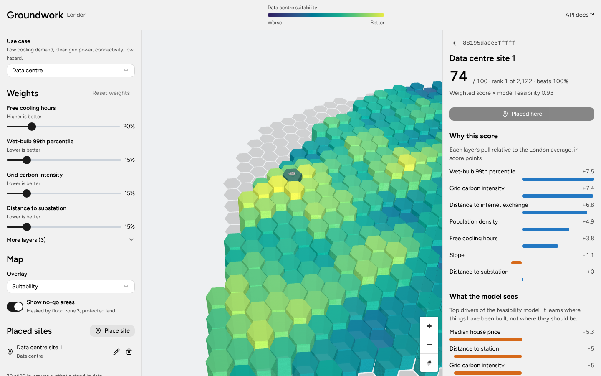
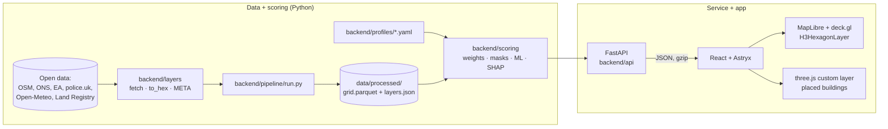

# Groundwork

**Where is the ideal place to put this?** Groundwork splits a region into H3 hexagons, measures
dozens of environmental, infrastructure and social layers for each one, and scores every hexagon for
a use case: a data centre, a house, a school, a mine, or anything you describe in one YAML file. The
result is an interactive 3D map, a per-hexagon explanation of *why* a spot scores the way it does,
and a documented public API.

London is the demo region.



> **Data status:** the scoring library and pipeline are in place. The committed sample grid
> (`data/sample/`) still uses deterministic **synthetic** fallbacks for most layers until `make data`
> is run with network access. `GET /health` and the app both say which layers are real.

## Who it's for

The same engine serves different audiences, each with its own scoring profile. The full guide is [docs/use-cases.md](docs/use-cases.md).

- **Business:** data centres and compute-heavy sites (power, cooling, fibre, grid carbon), with an ML feasibility model trained locally or on Azure ML.
- **Consumers:** where to live (homes), weighing safety, transport, schools, green space and prices.
- **Government and public bodies:** schools, hospitals and renewables (solar and wind farms), for siting public infrastructure.
- **Custom:** describe any building ("a hydrogen refuelling station near motorways"). The Mistral agents find the data, build the profile and a 3D model, and score it.

## Built with Mistral

Mistral powers every natural-language part of Groundwork; scores themselves never come from an LLM. Full details are in [docs/mistral.md](docs/mistral.md).

- **Agents:** the **Planner** turns "I want to build X" into a use case (data layers, profile, 3D model, Azure ML training). The **Data Aggregator** does the same without ML when Azure isn't connected. Both run in-app (`POST /agent/run`) or as Mistral managed agents (`backend/agent/managed/`). Planning and error recovery use `mistral-large-latest`; routine steps use the faster `mistral-medium-latest` (`GROUNDWORK_AGENT_FAST_MODEL`), so a typical build takes about 1.5 minutes instead of 3.
- **Map commands:** `POST /assistant/command` turns typed or spoken requests into ordered map commands with `mistral-small-latest` (JSON mode). Without a key, a rule-based parser takes over.
- **Suitability reviewer:** `POST /assistant/review` (`mistral-small-latest`, with offline rules as fallback) stops impossible requests ("a house in the ocean") before anything runs.
- **Voxtral:** speech to text with `voxtral-mini-latest`, and spoken replies with `voxtral-mini-tts-latest` (voice Paul, with a tone picked per reply). With the mic on, each phrase is sent automatically when you pause.

One `MISTRAL_API_KEY` in `.env` (or Connections → Mistral) enables all of it. The key stays on the server.

## Features

- A three.js globe that turns to London and dives into its hex grid, in a dark, single-accent theme.
- Every hexagon of Greater London scored for four use cases, with a live 0–100 score and rank.
- Weight sliders re-score the whole city in about 200 ms. The map stays visible while it updates.
- "Why this score": each layer's signed pull relative to the London average.
- An ML feasibility model with SHAP drivers for profiles that declare one.
- Overlays for suitability, thermal, height (with hillshade and optional 3D terrain), flood, crime,
  air quality, and any other layer.
- Place a building on any hexagon: low-poly three.js models that grow from the clicked spot. Rename
  and remove placed sites, and compare two of them side by side.
- A FastAPI service with real schemas, examples and error bodies at `/docs` and `/redoc`.
- New use cases need one YAML file and no code.

## Architecture



- **Layers** are the data: one value per hexagon, normalised to a 0–1 percentile rank (higher = more of
  the thing), plus the raw value in its original unit.
- **Profiles** are the use cases: which layers matter, how much, which direction is better, and
  which layers are hard no-go **masks**.
- **The scorer** combines them: `score = sustainability × feasibility`. Sustainability is the
  weighted sum of direction-corrected layers. Feasibility is an optional ML model (1.0 when a profile has
  none). Masked hexagons get `score: null`.

The two halves meet only at the contracts in [`shared/contracts/`](shared/contracts/). Async
requests between the two halves go in [docs/handoff.md](docs/handoff.md). More detail in
[docs/architecture.md](docs/architecture.md).

## Prerequisites

| Tool | Version | Notes |
|---|---|---|
| Python | 3.11+ | |
| [uv](https://docs.astral.sh/uv/) | any | optional; the Makefile falls back to `python -m venv` + `pip` |
| Node.js | 20+ | npm comes with it |
| git | any | |
| make | any | optional on Windows, see below |

- **macOS:** `brew install python@3.12 node uv`. Xcode command-line tools supply `make`.
- **Linux:** use your package manager for Python 3.11+ and Node 20+, then
  `curl -LsSf https://astral.sh/uv/install.sh | sh`.
- **Windows (PowerShell):** `winget install Python.Python.3.12 OpenJS.NodeJS.LTS astral-sh.uv`.
  Without `make`, run the commands under each target by hand, for example:

  ```powershell
  uv venv .venv --python 3.11
  uv pip install --python .venv\Scripts\python.exe -r backend\api\requirements.txt -r backend\pipeline\requirements.txt
  Start-Process .venv\Scripts\python.exe -ArgumentList '-m','uvicorn','backend.api.main:app','--port','8000'
  cd frontend; npm ci; npm run dev
  ```

## Quick start (offline data, about 2 minutes)

```bash
git clone https://github.com/a1-x1/groundwork.git
```

```bash
cd groundwork
```

```bash
make dev
```

`make dev` installs whatever is missing (Python venv and packages, then `npm ci`) on the first run,
then starts the API and the web app together. Ctrl+C stops both. Open **http://localhost:5173**. API
docs are at **http://localhost:8000/docs** (and `/redoc`). Use other ports with
`make dev API_PORT=8001 WEB_PORT=5174`.

To run the two halves separately, use `make install`, then `make api` and `make web` in two terminals.

The app needs no data download: the API scores the committed sample grid in `data/sample/`. The basemap and terrain tiles are fetched online. Offline,
the map falls back to a plain background and the hexagons still render.

### Voice (Mistral Voxtral)

1. Put your key in `.env` at the repo root (`cp .env.example .env`, then set `MISTRAL_API_KEY=…`),
   or paste it in the app under **Connections → Connect with Mistral**.
2. Run `make dev` and open **http://localhost:5173/#voice-lab**. Allow the microphone, then tap the
   orb (or hold it while you talk). The page shows Voxtral's transcript, timings, the parser used
   (Mistral or offline rules) and the exact map commands as JSON. You can also upload a recording.
3. In the main app, the same orb sits in the **Assistant** box at the bottom of the map: tap to
   talk, mute spoken replies, or open the Voice Lab. Anything that isn't a map command goes to the
   planning agent.

Frontend-only work without the API:

```bash
cd frontend && VITE_USE_FIXTURE=true npm run dev
```

This uses `frontend/src/fixtures/`, which validates against the contract schema. Copy
`frontend/.env.example` to `frontend/.env` to change `VITE_API_URL`.

## Full data build

```bash
make install-pipeline
```

```bash
make data
```

- Limit to some layers: `make data LAYERS=dist_station,crime_rate`.
- Force the deterministic synthetic fallbacks (no network): `make data-offline`.
- Raw downloads are cached in `data/raw/`; outputs go to `data/processed/` (both gitignored).
- Sources, licences, download sizes and any free accounts are listed in
  [docs/data-sources.md](docs/data-sources.md) (maintained with the pipeline).

## Training models

```bash
make train
```

This trains a presence-only LightGBM model for each profile that declares `model:`, using spatial
block cross-validation, and saves it to `data/processed/models/<profile>.txt`.

**What the model means:** it learns where things **have been** built, not where they **should**
be. The weighted sustainability score is the normative part, which is why the two are multiplied
rather than averaged.

## API usage

The default port is 8000. `bbox` is always `min_lon,min_lat,max_lon,max_lat`.

```bash
curl http://localhost:8000/health
```

```bash
curl http://localhost:8000/profiles
```

```bash
curl http://localhost:8000/profiles/data_centre
```

```bash
curl http://localhost:8000/layers
```

```bash
curl "http://localhost:8000/layers/summer_max_temp?bbox=-0.2,51.45,0.0,51.55"
```

```bash
curl "http://localhost:8000/score/house?bbox=-0.2,51.45,0.0,51.55"
```

```bash
curl "http://localhost:8000/score/data_centre/point?lat=51.5155&lon=-0.0922"
```

```bash
curl -X POST http://localhost:8000/score/custom -H 'Content-Type: application/json' -d '{"profile": "data_centre", "weights": {"free_cooling_hours": 40, "dist_fibre_ix": 30}}'
```

```bash
curl "http://localhost:8000/compare?profiles=data_centre,house,school,mine&lat=51.5155&lon=-0.0922"
```

Check a request before acting on it (the Mistral suitability reviewer; obvious cases are caught
offline):

```bash
curl -X POST http://localhost:8000/assistant/review -H 'Content-Type: application/json' -d '{"text": "build a house in the ocean"}'
```

Errors always look like `{"error": {"code": "not_found", "message": "...", "detail": null}}`:
`404` for an unknown profile, layer or location, and `422` for bad parameters or weights.

Set `GROUNDWORK_SCORING=stub` or `real` to force a backend. The default is `auto`, which uses the real one if it imports.

## Adding a new use case

Write one file, `backend/profiles/hospital.yaml`:

```yaml
id: hospital
label: Hospital
description: Reachable by many people, quiet, clean air, out of flood risk.
layers:
  population_density: {weight: 0.30, better: higher}
  dist_station:       {weight: 0.20, better: lower}
  dist_major_road:    {weight: 0.20, better: lower}
  air_quality_no2:    {weight: 0.15, better: lower}
  flood_risk:         {weight: 0.15, better: lower}
masks: [flood_zone_3, protected_land]
```

Restart the API. `hospital` then appears in `/profiles`, in the app's use-case picker, and at
`/score/hospital`. Weights are renormalised to sum to 1, and unknown layer ids fail loudly at
startup. Add a `model:` block (see `data_centre.yaml`) to multiply in a feasibility model. A
low-poly generic building is used until someone adds a model in `frontend/src/map/buildings.ts`.

## Adding a new layer

Create `backend/layers/<layer_id>.py`:

```python
import pandas as pd

META = {
    "id": "dist_hospital", "label": "Distance to hospital", "unit": "m",
    "kind": "proximity", "description": "To nearest A&E hospital.",
    "source": "OpenStreetMap (amenity=hospital)",
}

def fetch():
    """Download (cached in data/raw/) or fall back to a seeded synthetic pattern."""
    ...

def to_hex(raw, grid: pd.DataFrame) -> pd.Series:
    """One float per grid row, indexed like grid['h3'], in the layer's raw unit."""
    ...
```

Register it in the pipeline's layer list, then run `make data LAYERS=dist_hospital`. The pipeline
normalises it, writes `dist_hospital` and `raw_dist_hospital` to `grid.parquet`, and it shows up in
`/layers` and the app's overlay picker.

## Testing

```bash
make test
```

This runs API and contract tests (`backend/tests_api`, which validate every response against
`score_response.schema.json`), scoring tests (`backend/tests_scoring`), and the frontend
typecheck, lint and Vitest suite (which validates the fixture against the same schema).
`make lint` runs ruff and oxlint.

## Troubleshooting

- **macOS: "Library not loaded: libomp.dylib", or the app says "Can't reach the API":** LightGBM
  needs OpenMP. Run `brew install libomp`, then restart `make dev`. (`make dev` does this for you
  when Homebrew is installed.)
- **GDAL / rasterio fails to install:** use Python 3.11–3.12, where wheels exist. On macOS
  `brew install gdal`, on Debian/Ubuntu `apt install gdal-bin libgdal-dev`. Only the data pipeline
  needs these; the API and app do not.
- **Port already in use:** `make api API_PORT=8001` and set `VITE_API_URL=http://localhost:8001`, or
  `make web WEB_PORT=5174`. The API allows CORS from any `localhost` port.
- **CORS errors in the console:** open the app at `localhost`, not `127.0.0.1` with another port, and
  check that `VITE_API_URL` points at the running API.
- **Blank map / "WebGL not available":** enable hardware acceleration in the browser settings, or
  try Chrome or Firefox. Check `chrome://gpu`.
- **Slow on an integrated GPU:** the app watches frame rate while you move the map. If it drops,
  it extrudes only the top quarter of hexagons and turns 3D terrain off. Turning off "Show no-go
  areas" also helps.
- **Map shows a plain background:** the basemap tiles could not be fetched (offline or blocked).
  Data still renders.

## Data, limitations and ethics

Sources and licences: [docs/data-sources.md](docs/data-sources.md).

- This is a **decision-support demo, not planning advice**.
- The presence model reflects **historic decisions**, including their biases. It shows where
  things are, not where they ought to be.
- Crime and deprivation data can **encode bias**, both in policing and in reporting. Weighting
  them penalises places, and the people who live there, for being measured.
- Normalising by percentile rank within London makes scores relative to London, not absolute.
- Res-8 hexagons (~0.74 km²) are coarse; a single hexagon can contain very different streets.

## Future plans

- Any region worldwide: pluggable region definitions and global sources (ERA5, WRI Aqueduct water
  stress, Electricity Maps, WDPA, USGS mineral deposits, global population grids).
- Mineral-deposit and geology layers for the mine profile; tailings and downstream watershed analysis.
- Multi-resolution H3, from res 6 to 9 by zoom level.
- User-defined profiles from the UI: weight presets saved locally and exported as YAML.
- Scenario modelling: 2050 temperature and flood projections, future grid decarbonisation.
- Placement impact: after placing a data centre, recompute nearby layers (grid load, heat reuse for
  nearby housing).
- Better ML: positive-unlabelled learning, spatial models, uncertainty maps.
- Vector tiles for large regions (PMTiles), with a PostGIS or DuckDB-spatial backend.
- Auth, rate limiting and a hosted public API.

## Team

- Person 1: data, profiles, scoring, ML
- Person 2: repo, API, frontend, docs

## Licence

[MIT](LICENSE)
