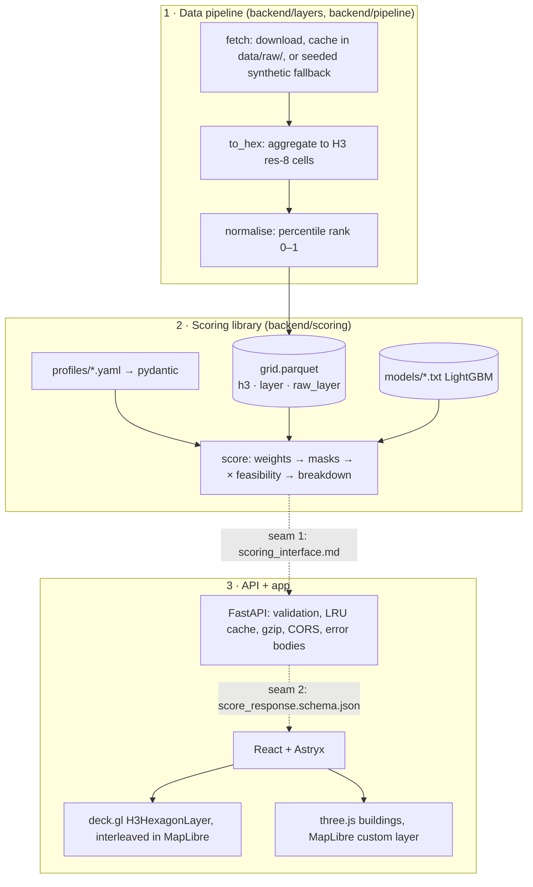

# Architecture

Groundwork has three parts with two seams between them. Each part can be built and tested on its own.

## Seams

1. **`backend.scoring` Python interface**, frozen in `shared/contracts/scoring_interface.md`. The API
   imports it and nothing else from the data side. `backend/api/scoring_source.py` selects either the
   real module or `backend/api/stub_scoring.py` (`GROUNDWORK_SCORING=auto|real|stub`), so the API and
   app were built before the data existed.
2. **HTTP JSON**, frozen for scores in `shared/contracts/score_response.schema.json`. Pydantic models
   in `backend/api/models.py` mirror it, `backend/tests_api/test_contract.py` validates live responses
   against it, and the frontend Vitest suite validates `frontend/src/fixtures/score_response.json`
   against it.

## Scoring

For profile *p* with layers *i*, renormalised weights *wᵢ* (Σ = 1), and normalised values *vᵢ*:

- direction-corrected value: *v′ᵢ = vᵢ* if higher is better, otherwise *1 − vᵢ*
- sustainability = Σ *wᵢ v′ᵢ*
- feasibility = model probability, or 1.0 when the profile has no model
- score = sustainability × feasibility, or `null` when any mask layer is set
- breakdown*ᵢ* = *wᵢ (v′ᵢ − mean(v′ᵢ))*: positive means this layer lifts the cell above the London average

The model learns where things *have* been built. The weighted score is the normative part, and
multiplying the two means a site must be both desirable and plausible.

## API

| Concern | How |
|---|---|
| Schemas in `/docs` | a pydantic `response_model` on every route, with summaries, descriptions, tags and examples |
| Caching | thread-safe LRU (64 entries) keyed by `(profile, sha1(weights), bbox)`; ranks cached per `(profile, weights)` |
| Errors | `KeyError` → 404, `ValueError` → 422, validation → 422; always `{"error": {code, message, detail}}` |
| Size | gzip over 1 KB; a full-city score response is ~2,500 cells |
| CORS | `http://localhost:5173` |

## Frontend

- **Layout:** Astryx `Layout`, with a header (title, legend, API docs), a start panel (use case,
  weights, overlay, placed sites), the map as content, and an end panel (best sites, hexagon detail,
  or site comparison). The end panel is always present, so selecting a hexagon never resizes the map.
- **State:** `src/state/useGroundwork.ts`. A profile change scores immediately. A weight change is
  debounced by 200 ms and keeps the current map on screen. On failure the sliders roll back to the
  last weights the server accepted and an inline message appears. Out-of-order responses are dropped
  with sequence numbers.
- **Map:** MapLibre basemap (CARTO Positron or Dark Matter, matching the colour scheme, with a plain
  fallback offline), deck.gl `MapboxOverlay` in interleaved mode, and one extruded `H3HexagonLayer`
  with interpolated transitions on elevation and colour (none under `prefers-reduced-motion`).
  Terrarium DEM tiles drive the hillshade and optional MapLibre 3D terrain in the Height view.
- **Colour:** every ramp is built in OKLCH (`src/lib/colour.ts`) with monotonic lightness. A unit
  test checks this, so ramps stay ordered for colour-blind viewers. Breakdown bars use a blue/orange
  diverging pair.
- **Buildings:** `src/map/buildings.ts` holds one parametric low-poly model per profile (each well
  under 5k triangles, with instanced roof units on the data centre). They use Lambert materials, one
  directional and one ambient light, and no shadows. All are drawn by a MapLibre custom layer that
  shares the map's GL context and camera. Each grows from its hexagon with an ease-out-back
  animation and sits on top of the hexagon's column.
- **Performance:** device pixel ratio capped at 2. A frame-rate watchdog measures render events
  during camera moves; after two slow moves (< 24 fps) it extrudes only the top quarter of hexagons
  and disables 3D terrain.

## Future work

See the README's "Future plans". The main architectural changes would be pluggable region
definitions, multi-resolution H3 served as vector tiles (PMTiles), and a DuckDB-spatial or PostGIS
backend in place of a single parquet file.
